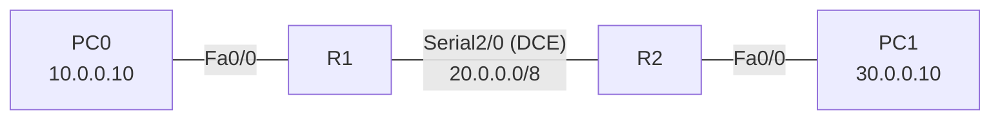

# 01 – Statik Yönlendirme

İki farklı ağı, aralarında seri hat bulunan iki router ve statik rotalarla birbirine bağlama.

## Topoloji



## Adresleme

| Cihaz | Arayüz | IP Adresi | Maske | Gateway |
|-------|--------|-----------|-------|---------|
| R1 | Fa0/0 | 10.0.0.1 | 255.0.0.0 | – |
| R1 | Serial2/0 | 20.0.0.1 | 255.0.0.0 | – |
| R2 | Fa0/0 | 30.0.0.1 | 255.0.0.0 | – |
| R2 | Serial2/0 | 20.0.0.2 | 255.0.0.0 | – |
| PC0 | Fa0 | 10.0.0.10 | 255.0.0.0 | 10.0.0.1 |
| PC1 | Fa0 | 30.0.0.10 | 255.0.0.0 | 30.0.0.1 |

## Yapılandırma
- [R1](configs/R1.txt)
- [R2](configs/R2.txt)

Router'lar yalnızca doğrudan bağlı ağları bilir. R1 30.0.0.0 ağını, R2 de 10.0.0.0 ağını tanımadığı için her iki router'a statik rota eklendi:

```
R1(config)# ip route 30.0.0.0 255.0.0.0 20.0.0.2
R2(config)# ip route 10.0.0.0 255.0.0.0 20.0.0.1
```

## Test

```
R1# show ip interface brief     ! Serial2/0 up/up olmalı
R1# show ip route               ! S 30.0.0.0/8 [1/0] via 20.0.0.2
PC0> ping 30.0.0.10
```

Hatanın hangi noktada olduğunu bulmak için adım adım ping: `10.0.0.1` → `20.0.0.2` → `30.0.0.1` → `30.0.0.10`.

## Karşılaştığım sorunlar

| Belirti | Sebep | Çözüm |
|---------|-------|-------|
| `Serial2/0 up / down` | İki uçta encapsulation farklı / karşı uç yapılandırılmamış | İki router'da da `encapsulation ppp` ve `no shutdown` |
| Seri hat up/up ama ping `Request timed out` | R2'nin seri arayüzüne de `20.0.0.1` yazılmıştı (aynı IP iki uçta). `show ip route`'ta karşı ucun host rotası `20.0.0.1/32` olarak görünüyordu | R2 Serial2/0 → `ip address 20.0.0.2 255.0.0.0` |

## Notlar
- `clock rate` yalnızca seri kablonun **DCE** ucuna yazılır. Hangi ucun DCE olduğu `show controllers serial 2/0` ile görülür.
- İlk ping'lerde 1–2 paket kaybı ARP çözümlemesinden kaynaklanır ve normaldir.
