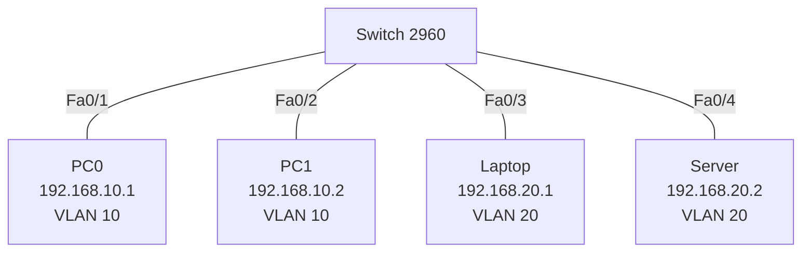

# 02 – VLAN

Tek bir switch'i VLAN'larla iki mantıksal ağa bölme. Aynı VLAN'daki cihazlar haberleşir, farklı VLAN'dakiler haberleşemez.

## Topoloji



## Adresleme

| Port | Cihaz | IP Adresi | Maske | VLAN |
|------|-------|-----------|-------|------|
| Fa0/1 | PC0 | 192.168.10.1 | 255.255.255.0 | 10 |
| Fa0/2 | PC1 | 192.168.10.2 | 255.255.255.0 | 10 |
| Fa0/3 | Laptop | 192.168.20.1 | 255.255.255.0 | 20 |
| Fa0/4 | Server | 192.168.20.2 | 255.255.255.0 | 20 |

## Yapılandırma
- [Switch](configs/Switch.txt)

`switchport access vlan X` komutu, VLAN yoksa onu otomatik oluşturur (`% Access VLAN does not exist. Creating vlan X`), bu yüzden `vlan 10` / `vlan 20` komutları ayrıca yazılmadı.

## Test

```
Switch# show vlan brief
PC0> ping 192.168.10.2      ! başarılı (aynı VLAN)
PC0> ping 192.168.20.1      ! başarısız (farklı VLAN, router yok)
```

## Ek komutlar
| Komut | Açıklama |
|-------|----------|
| `show interfaces fa0/1 switchport` | Portun modu ve VLAN'ı |
| `interface range fa0/1 - 2` | Birden fazla portu aynı anda yapılandırma |
| `no vlan 30` | VLAN silme |
