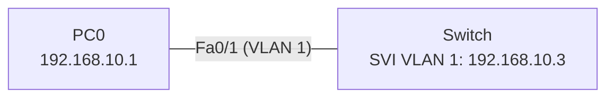

# 03 – Telnet ile Uzaktan Yönetim

02 numaralı VLAN lab'ının üzerine, switch'e yönetim IP'si verip bir PC'den Telnet ile bağlanma.

## Topoloji



## Yapılandırma
- [Switch](configs/Switch.txt)

| Adım | Komut | Açıklama |
|------|-------|----------|
| Yönetim IP'si | `interface vlan 1` → `ip address 192.168.10.3 255.255.255.0` | VLAN 1 varsayılan olarak vardır; bu komut yeni VLAN oluşturmaz, switch'e sanal bir arayüz (SVI) açar |
| Kullanıcı | `username test password 123` | Telnet girişinde sorulan kullanıcı |
| Uzak erişim | `line vty 0 4` → `login local` | 5 eşzamanlı Telnet oturumu, yerel kullanıcıyla giriş |
| Enable şifresi | `enable secret 12345` | `enable password`'dan farklı olarak şifreli saklanır; ikisi de varsa secret geçerlidir |
| PC portu | `interface fa0/1` → `switchport access vlan 1` | PC, switch'in yönetim IP'siyle aynı VLAN'da olmalı |

## Test

```
PC0> telnet 192.168.10.3
Trying 192.168.10.3 ...Open

User Access Verification
Username: test
Password: 123
Switch> enable
Password: 12345
Switch#
```

```
Switch# show running-config     ! enable password açık, enable secret şifreli görünür
```

## Not
Telnet trafiği (şifreler dahil) açık metin olarak iletilir. Gerçek ağlarda yerine SSH kullanılır.
