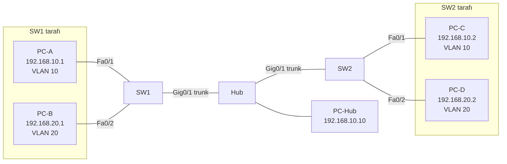

# 04 – Trunk, DTP ve Native VLAN

İki switch'i trunk ile bağlayıp VLAN'ları switch'ler arasında taşıma. Trunk hattı üzerindeki bir hub'a bağlı PC'yi native VLAN ile VLAN 10'a dahil etme.

## Topoloji



Tüm cihazlarda maske `255.255.255.0`.

## Yapılandırma
- [Switch1](configs/Switch1.txt)
- [Switch2](configs/Switch2.txt)

## DTP

| Switch1 | Switch2 | Sonuç |
|---------|---------|-------|
| dynamic auto | dynamic auto | Trunk oluşmaz |
| dynamic desirable | dynamic auto | Trunk |
| dynamic desirable | dynamic desirable | Trunk |
| trunk | dynamic auto / desirable | Trunk |

Switch1'de `dynamic desirable`, Switch2'de varsayılan `dynamic auto` kullanıldı.

## Native VLAN
Trunk üzerinde etiketsiz (untagged) gelen çerçeveler native VLAN'a atanır (varsayılan VLAN 1). Hub 802.1Q etiketini bilmediği için hub'daki PC'nin trafiği VLAN 1'e düşüyor ve VLAN 10'daki cihazlarla haberleşemiyordu. Native VLAN iki switch'te de 10 yapılınca hub'daki PC VLAN 10'un parçası oldu.

## Test

```
Switch# show interfaces trunk
Switch# show interfaces gig0/1 switchport
Switch# show cdp neighbors
Switch# show mac address-table
PC-A> ping 192.168.10.2      ! başarılı
PC-A> ping 192.168.10.10     ! başarılı (native VLAN 10 sonrası)
PC-B> ping 192.168.20.2      ! başarılı
PC-A> ping 192.168.20.1      ! başarısız (farklı VLAN)
```

## Karşılaştığım sorunlar

| Belirti | Sebep | Çözüm |
|---------|-------|-------|
| Hub'daki PC'ye ping atılamıyor | Etiketsiz trafik native VLAN 1'e düşüyor | `switchport trunk native vlan 10` |
| `%CDP-4-NATIVE_VLAN_MISMATCH` | Native VLAN yalnızca bir switch'te değiştirildi | İki uçta da aynı native VLAN |

## Allowed VLAN

```
Switch1(config-if)# switchport trunk allowed vlan remove 20
```

VLAN 20 trunk'tan geçirilmez; switch'ler arasında VLAN 20 haberleşmesi kesilir. Diğer seçenekler: `add`, `except`, `all`, `none`.
