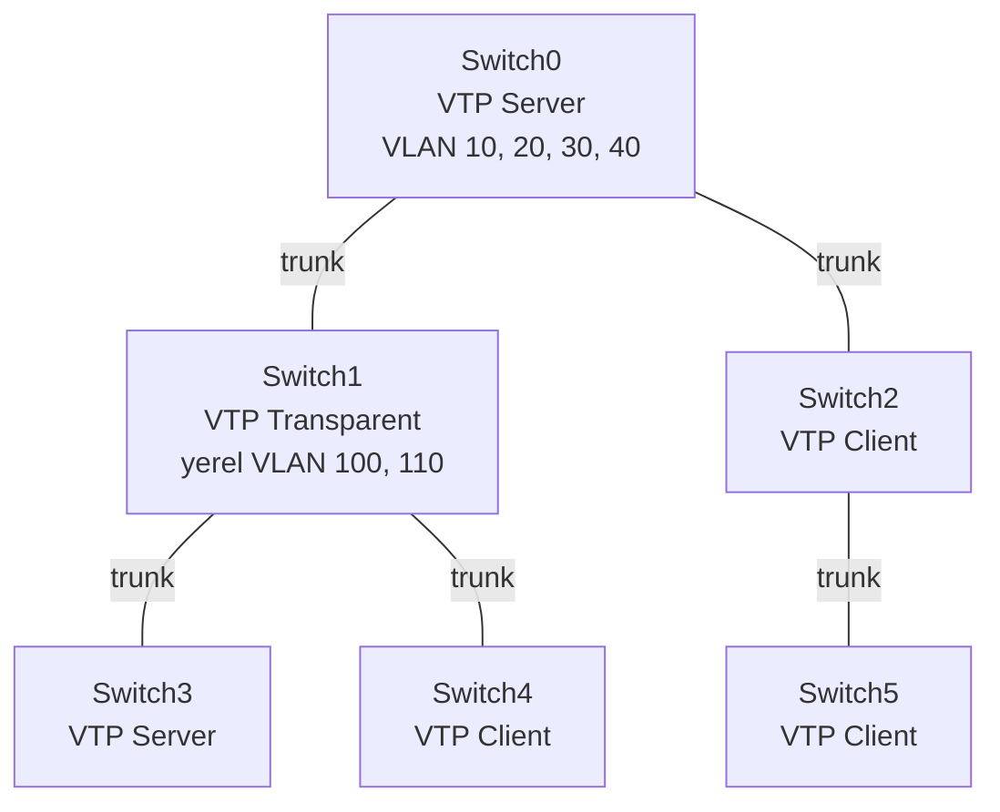

# 05 – VTP (VLAN Trunking Protocol)

VLAN'ları tek bir switch'te (server) oluşturup trunk hatları üzerinden diğer switch'lere otomatik dağıtma.

## Topoloji



Switch'ler 2960-24TT, aralarındaki bağlantılar çapraz (crossover) kablo. Trunk yalnızca ortadaki Switch0, Switch1 ve Switch2'de `interface range f0/1 - 3` → `switchport mode trunk` ile yapılandırıldı. Uçtaki Switch3, Switch4 ve Switch5'in portları varsayılan `dynamic auto` modunda olduğu için karşı taraf trunk olunca onlar da trunk'a geçti. VTP bilgisi yalnızca trunk hatlarından taşınır.

## Yapılandırma
- [Switch0 – Server](configs/Switch0-server.txt)
- [Switch1 – Transparent](configs/Switch1-transparent.txt)
- [Switch2 – Client](configs/Switch2-client.txt)
- [Switch3, Switch4, Switch5](configs/Switch3-4-5.txt)

## VTP modları

| Mod | VLAN oluşturma | Davranış |
|-----|----------------|----------|
| Server (varsayılan) | Evet | VLAN'ları oluşturur ve domain'e dağıtır |
| Client | Hayır | Server'dan gelen VLAN'ları uygular |
| Transparent | Yalnızca yerel | VTP'ye katılmaz, kendi VLAN'larını tutar, VTP mesajlarını iletir |

## Test

```
Switch# show vtp status
Switch# show vlan brief
```

| Adım | Gözlem |
|------|--------|
| Server'da `vtp domain cisco` | Diğer switch'ler domain adını trunk üzerinden öğrendi |
| Client'ta `vlan 30` | `VTP VLAN configuration not allowed when device is in CLIENT mode.` |
| Server'da VLAN 10, 20, 30, 40 | Client'larda `show vlan brief` ile otomatik göründü |
| Server'da `show vtp status` | Configuration Revision her değişiklikte 1 arttı (4) |
| Transparent'ta `show vlan brief` | Server'ın VLAN'ları yok; yerel VLAN 100 ve 110 oluşturuldu, diğer switch'lere yayılmadı |

## Not
Revision numarası yüksek olan bilgi geçerli kabul edilir. Başka bir ortamdan getirilen, revision'ı yüksek bir switch ağa bağlanırsa tüm domain'deki VLAN listesinin üzerine yazabilir. Yeni switch'i ağa eklemeden önce revision'ı sıfırlamak için domain adı geçici olarak değiştirilir ya da switch transparent moda alınıp geri getirilir.
